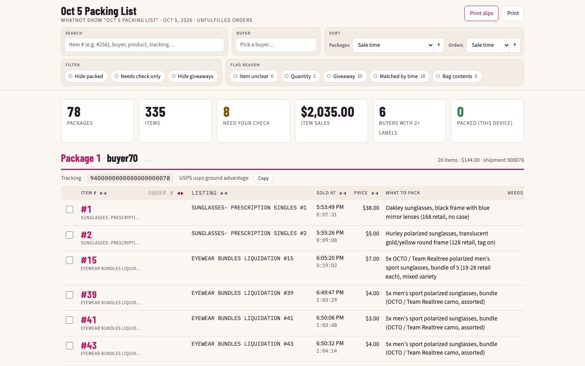
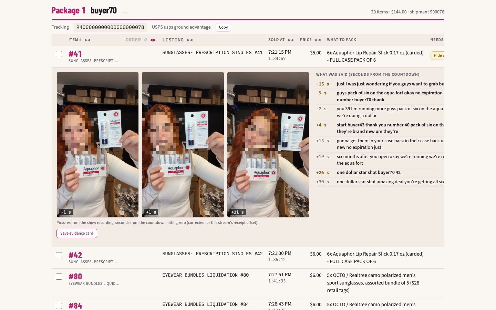
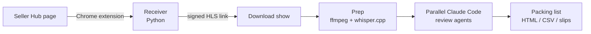

# Whatnot Packing List

Turns a Whatnot live-sale recording into a verified packing list: which product went to which buyer,
with photo and transcript evidence for every order.



## The problem

Whatnot sellers run "random pull" and "mystery bundle" auctions. The listing says "Beauty pulls #162",
and the actual product (brand, shade, bundle size) exists only in the video at the moment of sale.
After a 300 to 900 order show, the only way to pack correctly was to rewatch the whole stream.

## What it does

1. **One click in Seller Hub.** A Chrome extension (Manifest V3) reads the show's orders, packages and
   video-receipt timestamps from the page's own data request, then sends them with the show's signed
   video link. A 963-order show takes under a minute.
2. **Receiver.** A small Python HTTP service validates the bundle, checks an access code and show credits,
   and downloads the full HLS recording. No video passes through the seller's computer.
3. **Prep.** ffmpeg cuts audio and frames around each purchase; whisper.cpp transcribes the seller's
   callouts ("Maria 171"); the pipeline measures each stream's lag and grabs three sharp frames per order.
4. **AI review.** Orders are split into chunks and reviewed by parallel Claude Code agents, which match
   each sale to its product using the frames and transcript. A watchdog reads each agent's notes file
   from disk and stops any agent that stalls.
5. **Packing list.** An HTML page (plus CSV and Markdown) grouped by package, with search, filters,
   "needs your check" flags, printable 4x6 packing slips, and an evidence card per order.
6. **Resends.** If orders change after the show, a resend rebuilds the list and highlights orders added,
   removed, or moved between packages.





## Repo layout

| Folder | What's in it |
| --- | --- |
| `extension/` | Chrome extension: Seller Hub panel, order collection, settings, welcome page |
| `receiver/` | Python receiver, client access codes and credits, local-only admin page |
| `pipeline/` | `run.py` (prep, lag, chunking, build), page and slip templates, agent review instructions, `SKILL.md` |
| `site/` | Landing page and setup guide |
| `tests/` | 71 pytest tests with anonymized fixtures from real shows |

## Run the tests

```bash
python3 -m pytest -q
```

## Notes

- Built by directing AI coding agents (Claude Code); I designed the workflow, reviewed the changes, and
  run the tool on real shows.
- This is a public copy. Buyer names, the product catalog, and the live service address are replaced
  with samples or placeholders (`https://your-receiver.example.com`). Screenshots use made-up buyer
  names, with the host's face pixelated.
